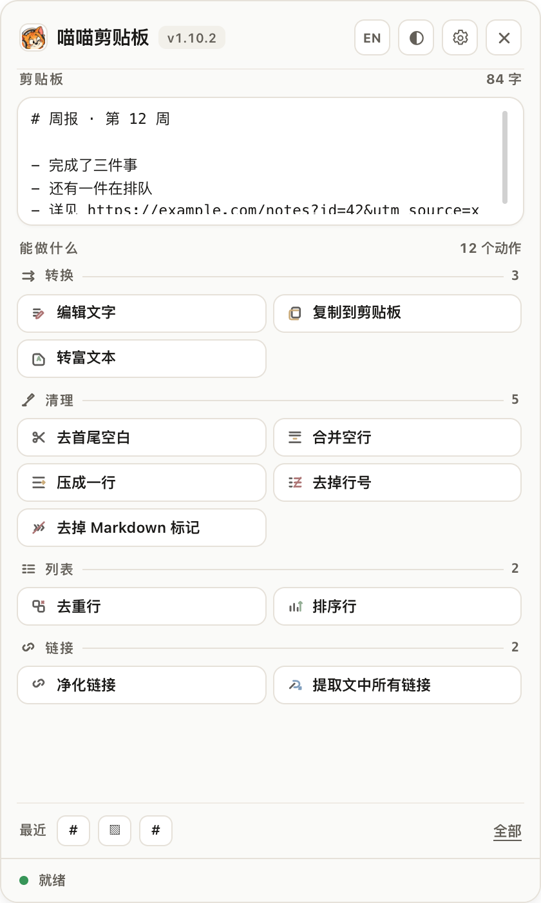
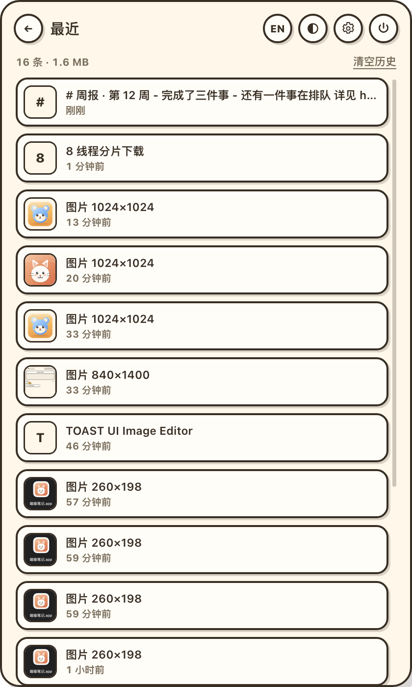
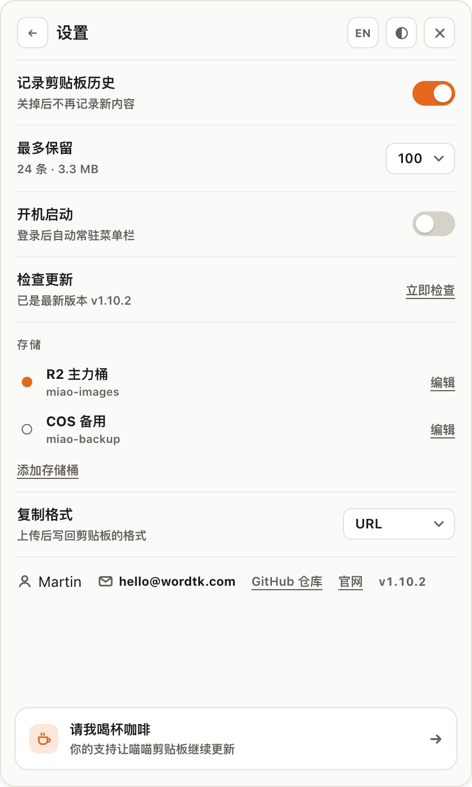
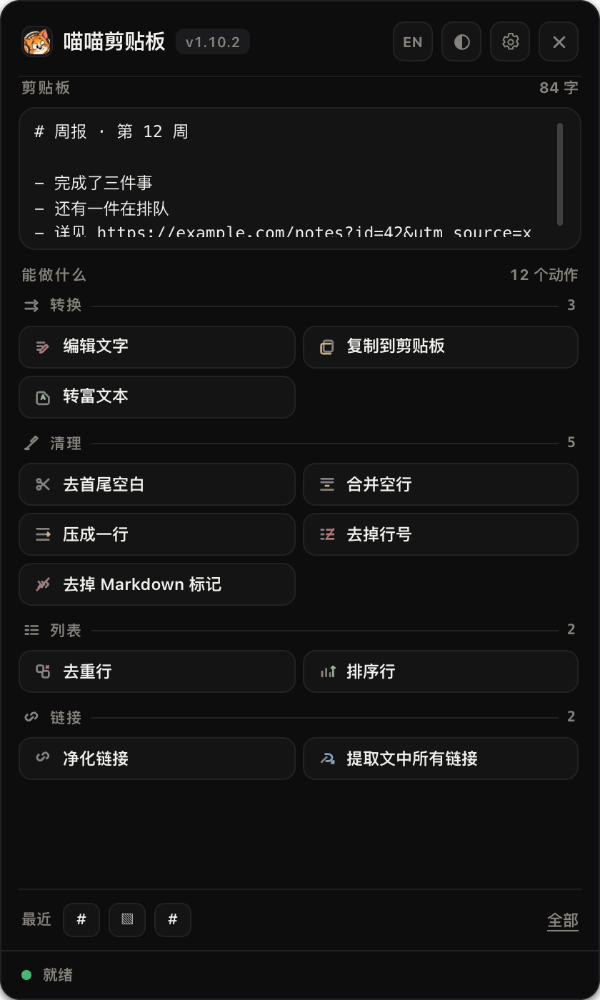
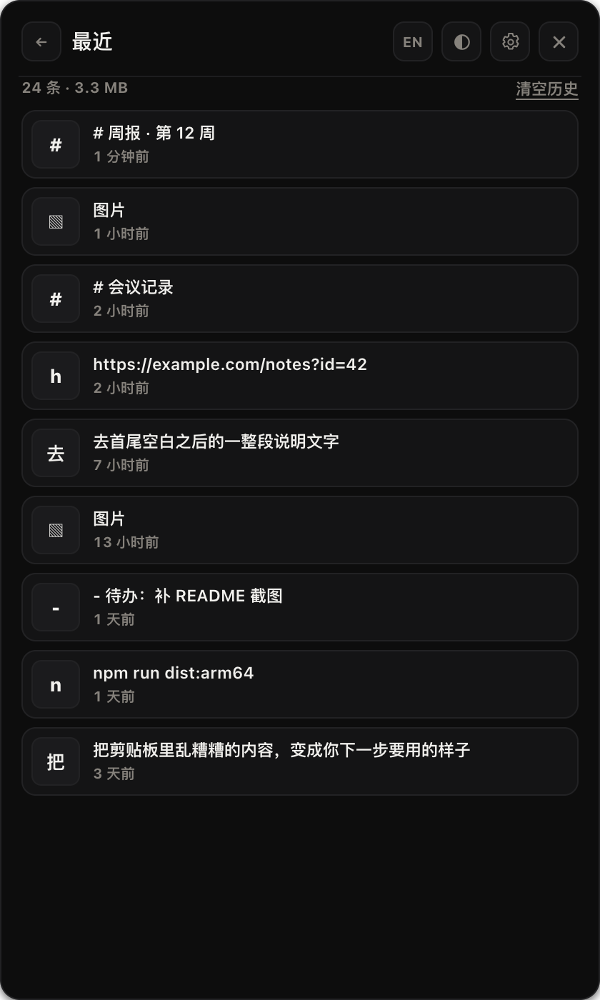
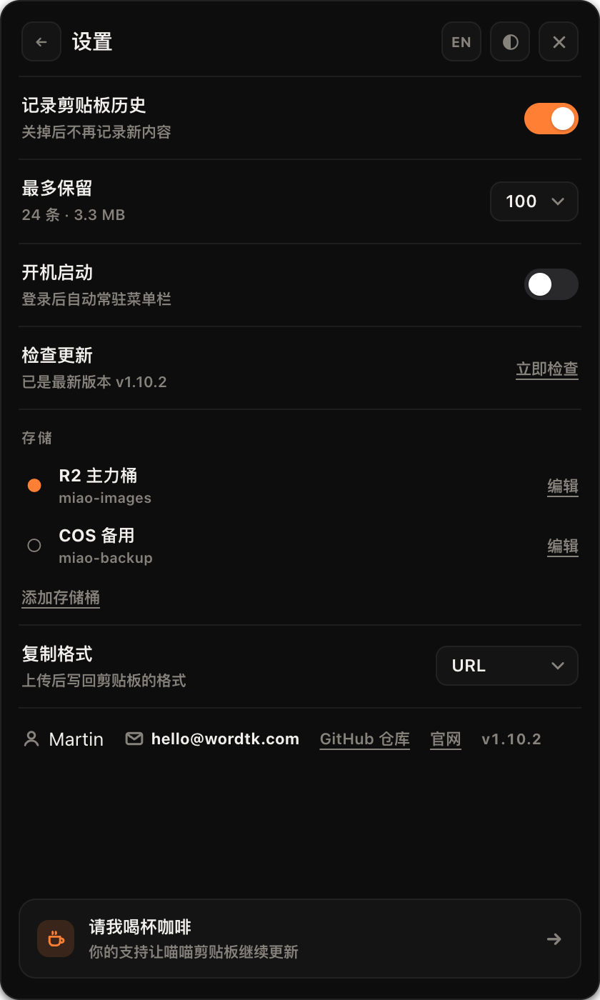

<div align="center">


# miaomiao-bar · 喵喵剪贴板

**The clipboard workbench for macOS: whatever lands on it — a paragraph, a column of names, a picture — comes back cleaned, tidied and ready to paste.**

<a href="https://bar.wordtk.com"></a>


<br/>


<br/><br/>

🇺🇸 **English** &nbsp;·&nbsp; [🇨🇳 简体中文](README.zh-CN.md)

</div>

> Copy something messy, click the menu bar, pick what it should become. Miaomiao Bar rewrites the
> clipboard in place, so the next **⌘V** is already right: plain text without the web styling,
> Chinese and English properly spaced, a list squeezed into one line, a link without the
> `utm_source=…` tail.
>
> No account, no window to manage, no network call. The panel shows **what the current clipboard can
> become**, never a fixed menu of everything the app can do.

---

## Table of contents

| | |
| --- | --- |
| [What it does](#what-it-does) | [Actions](#actions) |
| [Shortcuts](#shortcuts) | [How it works](#how-it-works) |
| [Privacy](#privacy) | [Project layout](#project-layout) |
| [Build from source](#build-from-source) | [Status](#status) |
| [License](#license) | |

---

## Install

Grab the dmg from **[bar.wordtk.com](https://bar.wordtk.com)** (Apple Silicon and Intel), drag the
app into `Applications`, and launch it. The build is ad-hoc signed rather than notarised, so the
first launch needs one extra step: after macOS blocks it, open **System Settings → Privacy & Security**
and choose **Open Anyway** (macOS 14 and older: right-click → Open).

Nothing to configure for the text tools. For image uploads, add a bucket in Settings → Storage — the
site's [image host section](https://bar.wordtk.com/#bucket) walks through the four fields that
matter.

## Screenshots

<p align="center">
  
  
  
</p>

### Dark mode

Toggle in the top bar — the choice is remembered, and the panel never changes appearance behind
your back when the system switches.

<p align="center">
  
  
  
</p>

## What it does

One model, one job: **clipboard in → transformation → clipboard out**.

- **Two appearances, no auto-switching.** A dark bar at night (charcoal and amber) and a light bar
  at daytime (cream paper and caramel ink). The switch lives in the top bar and the choice is
  remembered — nothing changes under you when macOS flips its own appearance.
- **Images get three buttons, nothing more.** Copy the picture back to the clipboard, open it in
  Preview (macOS's own editor), or send it to your bucket / Downloads.
- **A menu bar panel, not a window.** Click the tray icon, pick an action, paste. No dock icon, no
  window stealing a Space.
- **Only the actions that apply.** The list is filtered by what is actually on the clipboard right
  now: "To plain text" only appears for rich text, the typography group only when Chinese sits next
  to Latin, the tracking-link cleaner only for links that carry tracking.
- **Chinese typesetting, done properly.** A space between Chinese and Latin, and punctuation that
  belongs to the right script — the two things every Chinese writer fixes by hand.
- **Undo is one keystroke.** Every action keeps the previous clipboard, so a wrong pick costs a
  ⌥⌘Z, not a re-copy.
- **Images go to your own bucket.** One click on a screenshot uploads it to Cloudflare R2, Tencent
  COS, Alibaba OSS or MinIO and puts the link back on the clipboard — as a URL, Markdown, HTML tag
  or BBCode.
- **Zero runtime dependencies.** Only Electron itself; signing, storage and every transformation are
  hand-written on top of Node's built-ins.

Who this is **not** for: there is no Base64 encoder, no regex playground and no timestamp converter
here. Those are developer tools, and this app deliberately belongs to whoever copies text — writers,
ops people, anyone tidying a list at midnight. Formatting JavaScript/CSS/HTML is out of scope too:
it needs a formatter dependency, which is exactly the weight this project refuses.

## Actions

Every action is a pure function; the registry decides what to show for the clipboard at hand. The
set is deliberately small: it is what a writer reaches for, not everything that is technically
possible.

**Rich text ⇄ Markdown go both ways.** Copy an article from a browser and get clean Markdown; write
Markdown and put *rich text* on the clipboard, so Word, WeChat or Mail paste it formatted while a
code editor still gets the Markdown source.

| Group | Actions |
| --- | --- |
| Convert | Edit text · **Copy to clipboard** · To plain text · **To Markdown** · **To rich text** |
| Clean up | Trim whitespace · Collapse blank lines · Join into one line · Strip line numbers · Remove invisible characters · Strip Markdown syntax |
| Type | Space between Chinese and Latin · Punctuation → full-width |
| Lists | Remove duplicate lines · Sort lines |
| Links | Clean tracking parameters · Extract every link |
| Image | Open in Preview · Copy to clipboard · Upload to your bucket · Save to Downloads |

Adding a tool means adding one file under `electron/actions/` — the panel, the tests and the IPC
surface pick it up automatically.

## Image hosting

Add a bucket in **Settings → Storage** and the image actions appear whenever the clipboard holds a
picture.

| Field | What to put there |
| --- | --- |
| Endpoint | `https://<account-id>.r2.cloudflarestorage.com` for R2, `https://cos.<region>.myqcloud.com` for COS, `https://oss-<region>.aliyuncs.com` for OSS |
| Region | `auto` for R2; the real region for COS/OSS |
| Bucket | The bucket name |
| Public domain | The domain your images are served from — this is the link you get back |
| Access key / Secret | An S3 key with write access; the secret is encrypted with the macOS Keychain |
| Path-style | On for MinIO and self-hosted, off for virtual-host buckets |

Object keys are content addressed (`images/2026/10/4f9c1a2b.png`), so the same picture uploaded
twice is one object. The link format (URL / Markdown / HTML / BBCode) is a setting, not a per-upload
choice.

## Images

Screenshots are macOS's job: `⌘⇧⌃4` puts a region straight on the clipboard and the panel picks it up.
From there the image gets three actions — copy back to the clipboard, open in Preview, or upload /
save. There is no capture shortcut of our own, so the app needs no Screen Recording permission and
never grabs the screen in the background.

## History

The bottom row of the panel keeps the last three things you copied; **All** opens the full list.

- Text and images, newest first, one character or a thumbnail as the preview
- Click any entry to put it back on the clipboard
- 100 items / 200 MB by default (50, 100 or 200 in settings), oldest dropped first
- Re-copying something moves it to the top instead of piling up duplicates
- Only what you copy — nothing is uploaded, ever
- Recording can be switched off at any time

## Shortcuts

| Keys | Action |
| --- | --- |
| `⌥⌘V` | Show / hide the panel |
| `⌥⌘Z` | Undo the last action |
| `Esc` | Close the panel |

The panel is mouse-first: no arrow-key cursor, no Enter to run. Click an action and it happens.

## How it works

```
electron/actions/   One file per group of transformations, pure functions
electron/clipboard.cjs
                    Clipboard read/write for Electron 44+'s async clipboard API
electron/main.cjs   Tray, panel window, shortcuts, IPC
src/                Panel renderer: preview, action grid, bilingual copy
```

Three rules keep it honest:

1. **Actions never touch Electron.** They take `{ kind, text, html }` and return `{ text }` or
   `{ error }`, which is why the whole set is covered by `node:test` with no dependency.
2. **The main process owns the clipboard.** The renderer only ever sees a preview and a list.
3. **Writing back is the end of the flow.** No drawers, no side files — the result is on the
   clipboard, ready to paste.

## Privacy

- The clipboard is read while the panel is open, and polled in the background to build history —
  every 1.2 s for text, every 3 s for images.
- History never leaves this Mac: it is an index plus image blobs in
  `~/Library/Application Support/喵喵剪贴板/`.
- Two network calls, both listed here. One is the `PUT` to the bucket you configured. The other is a
  single anonymous launch signal (a random device id generated on this Mac, the UTC date and the
  coarse country/city Cloudflare derives) that feeds [the usage page](https://bar.wordtk.com/stats);
  turning **Anonymous usage** off in Settings stops it immediately. No content, no IP, no user agent,
  no crash reporting, and the update check is a plain GET of the public release manifest.
- Turning history off stops recording immediately; **Clear history** deletes the index and every
  blob. Any single entry can also be deleted from the full list — hover a row and the delete button
  floats up on the right, which removes that entry and its blobs.
- There is no capture of our own: the app never reads the screen, so no Screen Recording permission
  is ever requested.
- No telemetry, no crash reporting, no update check.

## Project layout

```
electron/           Main process: tray, panel window, clipboard, IPC surface
electron/actions/   The transformation registry and its groups
electron/sigv4.cjs
                    AWS Signature V4 + S3 PUT, verified against the AWS test vector
electron/storage.cjs
                    Bucket configuration; secrets encrypted with the Keychain
electron/history.cjs
                    History index + image blobs, Electron-free and unit tested
electron/watcher.cjs
                    Clipboard poller (macOS has no clipboard change event)
electron/settings.cjs
                    Persisted switches and limits
src/                Renderer: panel markup, styles, i18n, DOM logic
src/styles/         One dark glass theme, no CSS framework
build/              Icon masters (PNG) and the generated icns
scripts/            afterPack hook that ad-hoc signs the bundle
tests/              node:test suites for the actions
```

The renderer never touches Node: everything goes through a narrow `contextBridge` with
`contextIsolation` and `sandbox` enabled.

## Build from source

```bash
npm install
npm run dev            # Vite + Electron with hot reload
npm test               # 120 unit tests, no dependencies
npm run dist:arm64     # dmg for Apple Silicon, output in release/
npm run dist:x64       # dmg for Intel (fetches the x64 native addon first)
```

No native modules ship with the app any more, so both architectures are pure Electron builds.

Put `VITE_SITE_URL=https://your-site.example` in a `.env` file at the repo root (it is
git-ignored). `npm run dist` then bakes it into the bundle, which feeds the settings page's
**Website** button, the tray's website item, the update check and the anonymous launch ping.
The domain never reaches the repository. Without it those features stay off and the buttons fall
back to the GitHub repository.

The marketing site lives in `site/` and deploys as its own Cloudflare Worker (`npm run deploy`
from inside it). It shares the **`common` D1 database** with sendtk, codetk and miaomiao-notes
(the free plan allows 10 databases), so its table is `bar_launches` with `bar_`-prefixed
indexes. Schema setup is `npx wrangler d1 migrations apply common --remote`; since
`d1_migrations` is a database-wide ledger keyed by file name, files in `site/migrations/`
keep the project prefix (`0001_bar_init.sql`).

## Status

`1.8.0`: 21 actions, image upload to your own S3-compatible bucket, save-to-Downloads and Preview,
local clipboard history, undo next to the action count, an update check, an anonymous usage page, and the bilingual panel. The app is now called 喵喵剪贴板 (Miaomiao Bar) and lives at **bar.wordtk.com**. The site lives at
**https://bar.wordtk.com**; dmgs for both architectures are served from Cloudflare R2.

## License

Dual-licensed:

- **Open source** — [AGPL-3.0-only](LICENSE). Free to use, modify and self-host. If you distribute
  a modified version, the AGPL requires you to publish the corresponding source as well.
- **Commercial** — if AGPL does not fit your product (for example, you want to ship a closed-source
  derivative) see [LICENSE-COMMERCIAL.md](LICENSE-COMMERCIAL.md).

The name "喵喵剪贴板 / miaomiao-bar" and the icon are not covered by the open-source grant.
